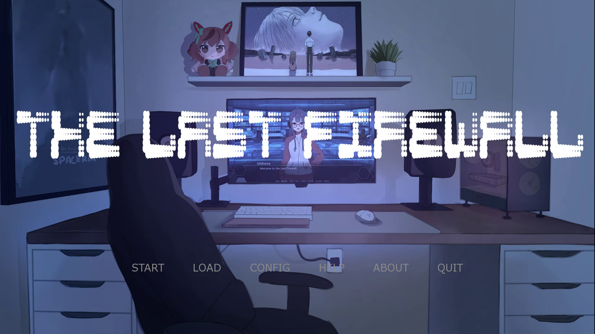
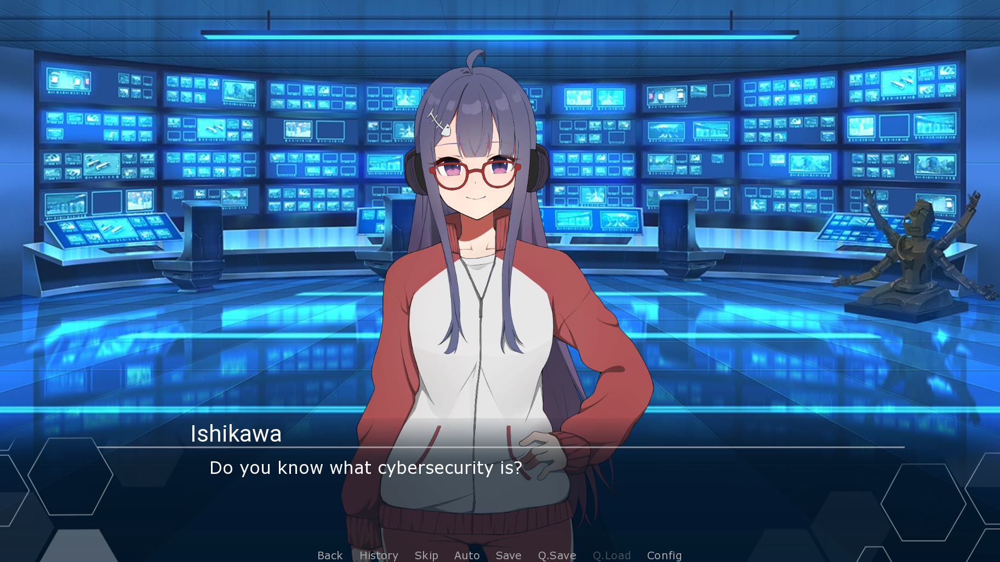
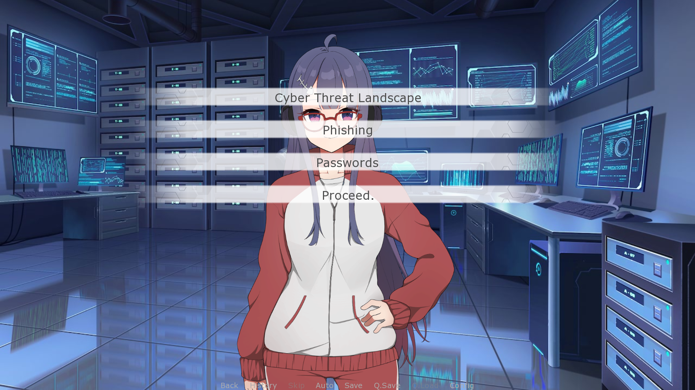
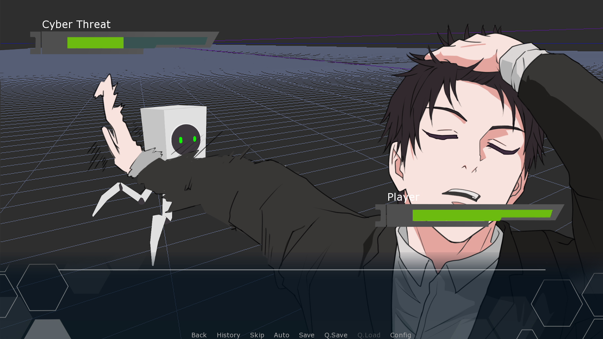
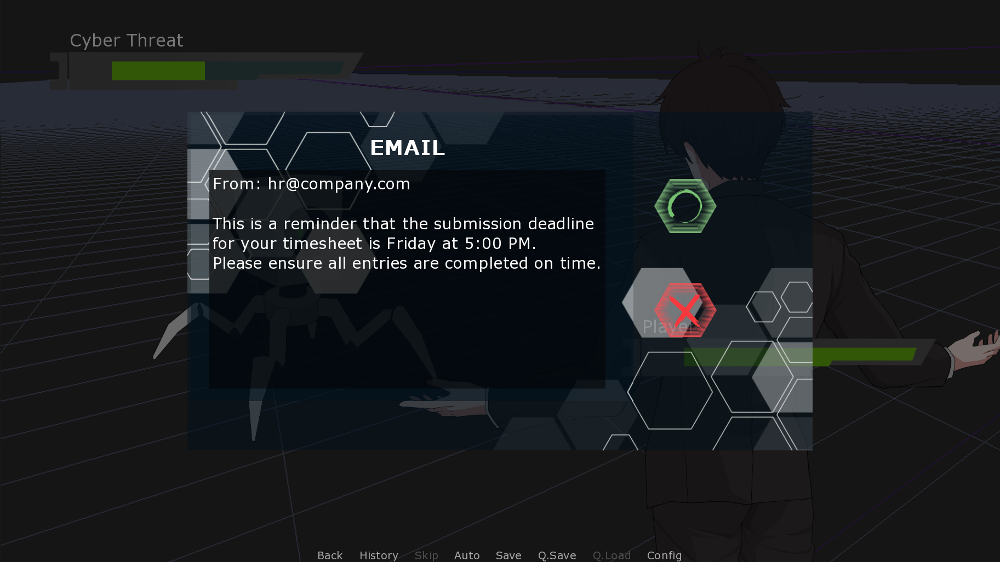
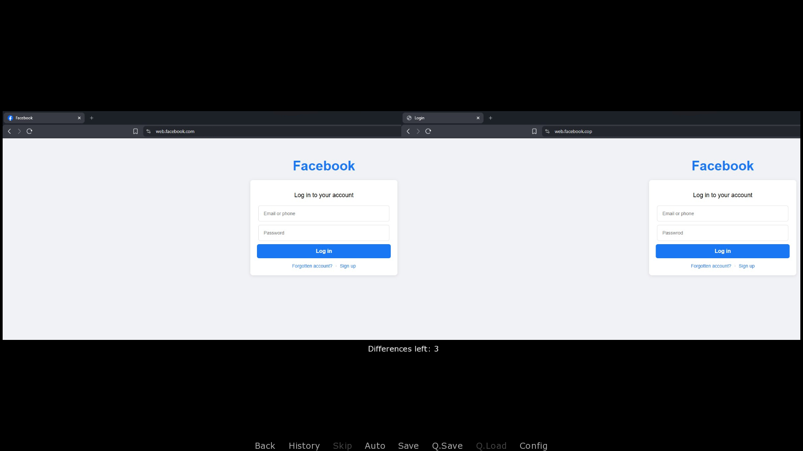
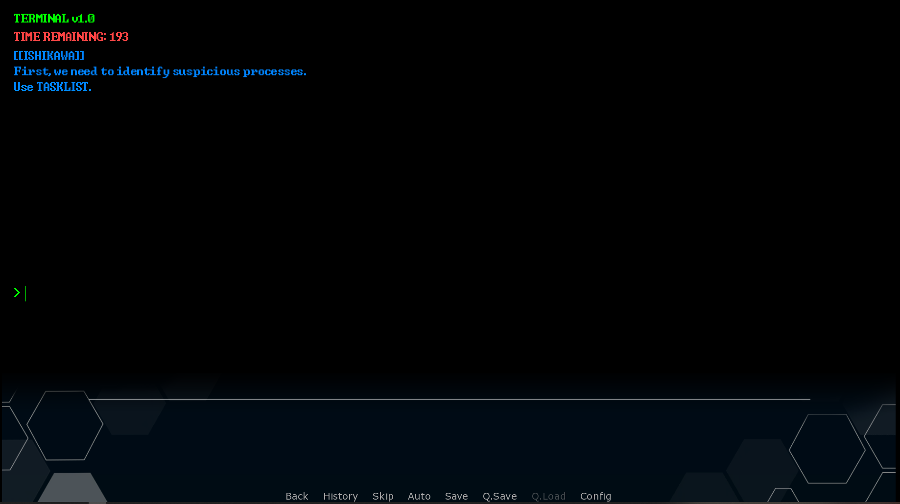

# The Last Firewall: An Educational Visual Novel for Cybersecurity Awareness

## Overview
The Last Firewall is an interactive visual novel designed to teach fundamental cybersecurity concepts through narrative-driven gameplay. The player assumes the role of an individual navigating real-world digital threats, where each decision directly impacts the outcome of the story.

This project aims to make cybersecurity education engaging, accessible, and memorable for non-technical audiences.

## Learning Objectives
This game is designed to help players identify phishing emails, malicious links, and social engineering attempts through interactive gameplay

# Screenshots

# Mini Games

## Turn-Based

## True or False

## Spot the Difference

## Terminal Simulation

